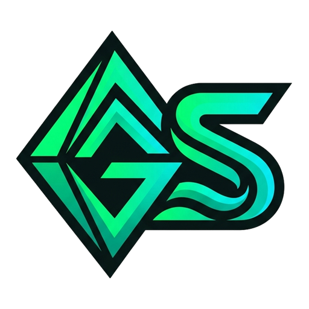

<div align="center">



# GreenScaler

**Decky Loader plugin for SteamOS & Linux (Steam Deck, Legion Go, Bazzite, CachyOS) to install & manage OptiScaler nightly + ANR FG + Streamline + MFG Unlocker + REFramework with FSR 4 presets.**

**English** | [Português (Brasil)](README.pt-BR.md) | [Features](#features) | [Installation](#installation-decky-loader) | [Requirements](#requirements) | [Build](#build-from-source) | [Releases](https://github.com/vaporgreen/GreenScaler/releases/latest)

<br />

[](https://github.com/vaporgreen/GreenScaler/releases/latest)
[](https://github.com/vaporgreen/GreenScaler/releases)
[](https://github.com/vaporgreen/GreenScaler/actions/workflows/sync-profiles.yml)
[](https://github.com/vaporgreen/GreenScaler/stargazers)


</div>

> **Nothing is redistributed.** GreenScaler fetches official upstream releases directly on demand and verifies SHA-256 checksums before touching any game folder:
> - [optiscaler/OptiScaler-nightly](https://github.com/optiscaler/OptiScaler-nightly/releases) (`.7z`, verified against the release SHA-256 digest)
> - [apex-compute/ANR](https://github.com/apex-compute/ANR/releases) (`anr-fg-*-addon.zip`, verified against `SHA256SUMS.txt`)
> - [NVIDIA-RTX/Streamline](https://github.com/NVIDIA-RTX/Streamline/releases) (Linux port of `Streamlined_fetcher_windows.bat` -> `OptiScaler/streamline/*.dll`)
> - [dashdogy/MFG-Unlocker](https://github.com/dashdogy/MFG-Unlocker/releases) (`MFGUnlocker.dll` verified against `SHA256SUMS.txt` -> `OptiScaler/plugins/MFGUnlocker.asi` + `[Plugins] LoadAsiPlugins=true`)
> - [praydog/REFramework-nightly](https://github.com/praydog/REFramework-nightly/releases) (auto-detected for Capcom RE Engine games, menu key moved to `Delete`)

## Features

- **OptiScaler Wiki + Proton Profile Database (`715+` games):** automatically synced from [optiscaler/OptiScaler.wiki](https://github.com/optiscaler/OptiScaler/wiki/Compatibility-List) + curated Linux/Proton AppID overrides, with a 1-click **Load recommended profile** button (proxy DLL, Streamline, `OptiScaler.ini` overrides, and Proton flags such as `PROTON_VKD3D_LOWLATENCY=1` / `-dx12`).
- **Proton Inspector + ProtonDB:** reads the game's assigned Proton (`config.vdf` + `compatibilitytools.d/`), warns when a Proton build may lack FSR 4 support (suggesting your installed `Proton-CachyOS` / `Proton-GE`), and shows the cached **ProtonDB** tier.
- **Per-Game Disk Scanner & Context Auto-Select:** scans all Steam libraries (including Unreal Engine 4/5 plugin directories), auto-selects the focused/running game in Gaming Mode, and detects **DLSS, DLSS-G, Streamline, FSR, XeSS, Anti-Cheat, and RE Engine**.
- **Clean Install / Proxy Swap / Uninstall:** deploys OptiScaler as `dxgi.dll`, `winmm.dll`, or `version.dll` (automatic via Wiki/Engine or manual override in QAM), backs up original game files with SHA-256 verification, and restores everything cleanly on uninstall.
- **Smart Launch Options Merging:** adds `WINEDLLOVERRIDES`, `PROTON_ENABLE_NVAPI=1`, and `PROTON_FSR4_UPGRADE=1` while **preserving existing options** (such as `--steamless`, `PROTON_VKD3D_LOWLATENCY=1`, etc.).
- **Handheld-Tuned Defaults:** on battery-powered devices (Steam Deck / Legion Go / ROG Ally), defaults to **FG 2X** and **FSR 4 INT8 Lite (`Fsr4Model=3`)**.
- **Streamline SDK Fetcher (Linux):** 1-click toggle for games that use **DLSSG via Streamline** (e.g., *The Blood of Dawnwalker*).
- **MFG Unlocker Plugin (`MFGUnlocker.asi`):** 1-click toggle to install `dashdogy/MFG-Unlocker` into `OptiScaler/plugins/` (unlocks **XeMFG up to 6X** on AMD/NVIDIA/Intel + adds the **MFG Unlocker** tab inside OptiScaler's `Insert` menu).
- **Auto-Update & Rollback:** checks for newer OptiScaler nightly + ANR add-on builds (at most once every 6 hours), keeps the previous working pair cached, and supports 1-click rollback.

## Installation (Decky Loader)

1. Download **`GreenScaler.zip`** from the [latest release](https://github.com/vaporgreen/GreenScaler/releases/latest).
2. On SteamOS Gaming Mode, open **Decky Loader → Settings → Developer → Install Plugin from ZIP** and select `GreenScaler.zip`.
3. Open **GreenScaler** from the Quick Access Menu (`...`), click **Buscar atualização** once to cache OptiScaler + ANR, select a game, and click **Instalar**.

## Requirements

- **Proton-GE** or **Proton-CachyOS** (or Proton 10/11 with FSR 4 support) for `PROTON_FSR4_UPGRADE=1`.
- `7z` or `bsdtar` installed on the system (included by default on SteamOS).

## Build from Source

```sh
npm install
npm run build   # outputs dist/index.js
```

Test the Python backend standalone (no Decky required):

```sh
PYTHONPATH=py_modules python3 -m greenscaler.core list
```

## Credits

- **OptiScaler** — [optiscaler/OptiScaler](https://github.com/optiscaler/OptiScaler)
- **ANR FG** — [apex-compute/ANR](https://github.com/apex-compute/ANR)
- **MFG Unlocker** — [dashdogy/MFG-Unlocker](https://github.com/dashdogy/MFG-Unlocker)
- **Streamline SDK** — [NVIDIA-RTX/Streamline](https://github.com/NVIDIA-RTX/Streamline)
- **REFramework** — [praydog/REFramework](https://github.com/praydog/REFramework)
